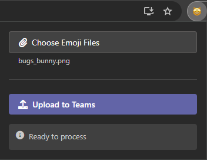
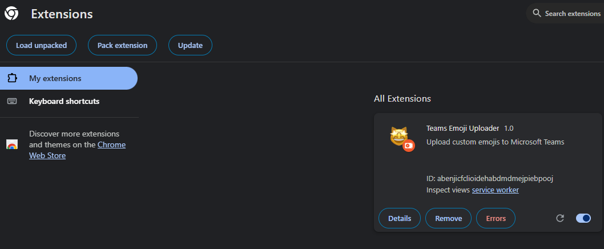

# 🎨 Teams Emoji Upload Extension

> **Archived:** I no longer have access to a Microsoft Teams workspace to test this extension, so I can no longer maintain it or verify that it works. Feel free to fork the repository, fix issues, and continue development in your own fork.

Bulk upload custom emojis to your Microsoft Teams organization.



## ✨ Features

- Bulk upload multiple emoji files simultaneously
- Works via Teams in the browser

## 📋 Prerequisites

- Active Microsoft Teams tab in Chrome

## 🚀 Installation

### From Chrome Web Store

Download [Teams Emoji Uploader](https://chromewebstore.google.com/detail/teams-emoji-uploader/mlajagdepghhbclefnmcdnjfhfdmoofo) from the Chrome Web Store

### From Source

1. Clone this repository
2. Install dependencies and build:

```console
npm install
npm run build
npm test
```

3. Open Chrome and navigate to `chrome://extensions`
4. Enable "Developer Mode" in the top right
5. Click "Load Unpacked" and select this repository folder



> 💡 **Tip**: After making changes, rebuild the project and refresh the extension in Chrome

## 🛠️ Development

### Formatting Code

```console
npm run format
```

### Running Tests

```console
npm test
```

## 🤝 Contributing

This repository is archived and is no longer accepting issues or pull requests. Forks and continued development are welcome!

## 📄 License

[MIT License](LICENSE)
